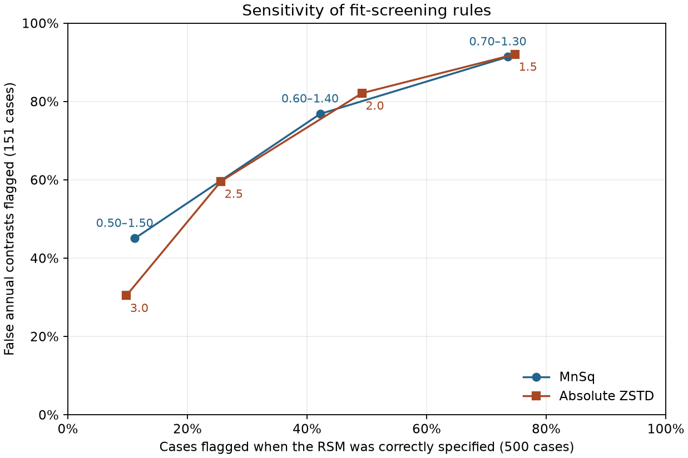
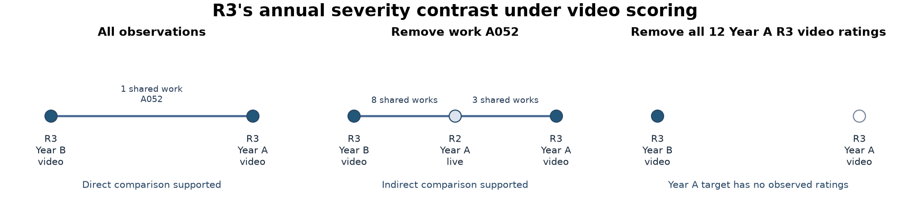

# M5b 同じ録画を使った年度間ドリフトの検証

## 問いと事前仕様

年1回のスピーチコンテストで、新しい発表者の水準が上がっても、継続審査員R3の厳しさが変化したかを識別できるか。さらに、R1・R2を安定とみなしたときに、その二人が実際には同じ方向に動くと、安定しているR3にどれだけ見かけの変化が出るかを調べる。[年度間の口頭評価研究](https://doi.org/10.1177/02655322241239363)・[共通審査員・課題のリンク実験](https://doi.org/10.3758/s13428-020-01498-x)

- 各年60録画を二人ずつで採点し、各年120評定、各審査員40評定を維持する。前年60録画を、2人の前年得点の合計の順位で20件ずつの低・中・高帯に分ける。同点は独立乱数で順序を決める。各帯から2本または8本を無作為に選ぶ。前年60本すべての評定をモデルに含め、前年得点を使う抽出を全反復で再現する。[得点による再採点標本の選択](https://doi.org/10.1002/ets2.12360)
- 三つの割付を比べる。6本を前年と同じペアが再採点、24本を同じペアが再採点、24本でペアを巡回して一人だけ前年と同じ審査員とする。再採点しない枠には新作を入れ、各年の審査員対ごとの担当録画数を20本ずつにそろえる。録画ID・発表者ID・発表年度・採点年度・審査員ID・視聴方式を別に保持する。同一発表者の翌年の新作にも新しい録画IDを割り当てる。主要条件では同じ録画と1〜5点の採点基準・同じ視聴方式を使う。
- 前年録画の水準は $N(0,1)$、翌年の新作は $N(0.75,1)$ とする。再使用する録画の水準は前年と同じ。前年のR1・R2・R3の厳しさは −0.6、0、+0.6 logit、ステップは −1.2、−0.4、+0.4、+1.2。新作の水準だけが上がる条件、R3だけが+0.5 logit厳しくなる条件、R1・R2だけが+0.5 logit厳しくなる条件、3人全員が+0.5 logit厳しくなる条件を、それぞれ500反復で調べる。潜在水準と得点生成用の乱数を同一反復内の条件間で共有する。
- 同じ録画の再採点を使って両年を同時に適合する。録画の発表年別に分布の位置を調整し、能力SDを1、両年のステップを共通とする。年度×審査員の厳しさを推定し、翌年−前年のR3の変化、3人の平均変化、R1・R2平均に対するR3の相対変化を分ける。比較としてR1・R2の両年の厳しさを前年の既知の生成値に固定する。両年のR3は自由に推定する。これは固定値の誤指定を見る実験で、前年の校正値そのものの標本誤差は含めない。
- 事前指定した点ごとのWald区間について、返却率、被覆率、偏り、RMSE、幅、両側5%での偽陽性率・検出力を各条件で記録する。報告範囲の目安はM2と同じく、返却率の95% Wilson下限80%以上、被覆率の95% Wilson区間全体が92–98%を満たすこと。誤った固定値の条件の区間も、真の年度差に対する性能を記録する。

## 録画の選び方と尺度の接続

例えば第1反復の前年合計点は、低・中・高帯でそれぞれ2–5点、5–7点、7–10点。同点を乱数で分けるので境界の点数は隣接する帯で重なる。各反復の母集団は各帯20本で、再採点したのは各帯2本または8本。前年の60本すべての得点を使うため、どれが再採点されたかは、観測済みの前年の評定と抽出用乱数で決まる。この選び方は、抽出した録画だけで前年からの得点差を単純集計する方法と異なる。新作を出した12人には別の録画IDを与えた。合成例では、同じ発表者の新作と旧作の潜在水準も録画ごとに独立に生成した。[第1反復の240評定](evidence/m5b_annual_drift_example.csv)

同時推定では、各録画に一つの潜在水準を置き、再採点された録画は両年の尤度に同じ水準を使う。発表年度ごとの位置を推定し、録画の水準と審査員の厳しさの共通原点を一つだけ制約する。R1・R2を前年値に固定するモデルでは、両年でR1とR2の厳しさの差を0.6 logitとし、二人の年度差を0にする。固定値が定める原点と録画の発表年度の位置の間では共通の平行移動を残す。推定にはGauss–Hermite 61点を使い、121点で勾配と全共分散を照合した。

### 共通録画を片側の得点帯から選ぶ場合

24本を同じ審査員対が再採点する割付を使う。各反復で、前年の低・中・高の3帯から8本ずつ選んだ既存条件を基準にする。高得点側・低得点側を優先する条件では、同じ反復の各審査員対の再採点本数を維持し、その対が前年に採点した録画を2人の観測合計点の高い順・低い順に選ぶ。同点は既存の無作為順で解消する。前年の120評定と翌年の新作36本の割付・評定、合計240評定は同一反復・同一生成効果では共通。共通録画には同じ潜在水準と再採点用乱数を使う。

真のR3の年度差0と+0.5 logitについて、それぞれ500反復を調べる。R1・R2は両年とも自由に推定する。固定SD MMLは前年未選出録画も含めて既存モデルを適合し、3帯条件は保存済み結果を使う。CMLは発表年度が録画ごとに一定なので、その係数を録画の位置とともに条件付けで消し、共通ステップと年度×審査員を用いる。選ばれた録画のR3の前年得点−翌年得点も点単位で集計する。これは選んだ録画の記述値で、モデルの厳しさの差とは単位が異なる。区間の返却率、M2と同じ基準での被覆率、幅、真値0での偽陽性率、真値+0.5での正方向検出を確認する。[採点標本の選び方と再採点比較](https://doi.org/10.1002/ets2.12360)・[共通作品の得点帯と評価者推定](https://doi.org/10.1177/0013164417703733)

#### 得点帯を変えたときの結果

選んだ24本の前年合計点は、3帯で平均5.979点、高得点側で7.947点、低得点側で4.041点だった。真のドリフトがゼロでも、再採点した録画のR3の前年得点−翌年得点は、高得点側で平均+0.380点、低得点側で−0.321点、3帯で+0.011点だった。全反復で割付はR3の年度差を支持し、全評定が一方の端点にそろった作品を除いても支持は残った。

| 手法 | 真の年度差（logit） | 共通録画の選び方 | 平均の偏り（logit） | 95%区間の被覆率（95% Wilson区間） | 偽陽性率／正方向検出率 | 区間幅中央値（logit） | M2の基準 |
|---|---:|---|---:|---:|---:|---:|---|
| 固定SD MML | 0 | 3帯 | +0.012 | 96.0%（93.90–97.40%） | 4.0% | 1.199 | 達成 |
| 固定SD MML | 0 | 低得点側 | +0.026 | 94.2%（91.79–95.93%） | 5.8% | 1.262 | 未達 |
| 固定SD MML | 0 | 高得点側 | −0.004 | 93.4%（90.88–95.26%） | 6.6% | 1.169 | 未達 |
| 固定SD MML | +0.5 | 3帯 | +0.026 | 96.6%（94.62–97.87%） | 38.8% | 1.238 | 達成 |
| 固定SD MML | +0.5 | 低得点側 | +0.042 | 94.8%（92.49–96.43%） | 34.0% | 1.334 | 達成 |
| 固定SD MML | +0.5 | 高得点側 | +0.004 | 95.0%（92.72–96.59%） | 37.8% | 1.173 | 達成 |
| CML | 0 | 3帯 | +0.013 | 96.6%（94.62–97.87%） | 3.4% | 1.278 | 達成 |
| CML | 0 | 低得点側 | −0.517 | 72.8%（68.74–76.52%） | 27.2% | 1.440 | 未達 |
| CML | 0 | 高得点側 | +0.467 | 71.0%（66.87–74.81%） | 29.0% | 1.262 | 未達 |
| CML | +0.5 | 3帯 | +0.042 | 96.8%（94.87–98.02%） | 32.8% | 1.340 | 未達 |
| CML | +0.5 | 低得点側 | −0.482 | 75.2%（71.23–78.78%） | 2.4% | 1.497 | 未達 |
| CML | +0.5 | 高得点側 | +0.482 | 73.6%（69.57–77.27%） | 83.8% | 1.339 | 未達 |

全条件で500/500件の区間が返った。表の誤り率は真値0なら区間がゼロを含まない割合、真値+0.5なら区間の下限がゼロを超えた割合。低得点側のCMLでは、真値+0.5でも、逆方向の区間が12件（2.4%）返った。真値0で3帯を基準にした同じ反復の推定値の移動は、CMLで低得点側−0.530、高得点側+0.453 logit（95%モンテカルロ区間はそれぞれ−0.557〜−0.503、+0.427〜+0.480）。固定SD MMLではそれぞれ+0.015、−0.016 logitで、どちらのモンテカルロ区間もゼロを含んだ。高得点側CMLの高い検出率は、真値0で増えた偽陽性と合わせて解釈する。[選定の集計と片側条件のMML](evidence/m5b_replay_score_bands_mml.csv.gz)・[CML全3,000件](evidence/m5b_replay_score_bands_cml.csv.gz)・[3帯の既存MML](evidence/m5b_annual_drift.csv.gz)

この実験では、前年の全評定を保持し、選定はその観測済みの評定と乱数から決まる。全観測を用いるMMLでは、前年の得点が高かったために選ばれた情報も尤度に入る。通常のCMLでは、観測枠を固定して録画の合計点で条件付けるため、前年の得点で再採点を選んだことが条件付きの比較に影響する。例えば5点の録画だけを再採点したとき、合計9点の前年・翌年の組 `(4,5)` と `(5,4)` のうち選定に適合するのは後者だけである。この影響の大きさは今回の5段階の生成条件・選定方法に対応する。前年の採点履歴、得点帯、審査員対別の抽出数は実務でも保存する。[再採点で前年得点を使う設計](https://onlinelibrary.wiley.com/doi/full/10.1002/ets2.12360)

第1反復の片側4条件でTAM 4.3.25とMMLの推定値・SEを照合し、最大差は1.3×10⁻⁸ logit未満。真値0の3条件を公開Python APIでも適合し、最大差は推定値5.6×10⁻⁶、SE 2.1×10⁻⁷ logit未満だった。mfrmr 0.2.4のCML全6条件をPythonの独立実装で照合し、推定値の最大差は4.4×10⁻⁹、SEは7.4×10⁻¹⁰ logit未満だった。

```sh
export OPENBLAS_NUM_THREADS=1 OMP_NUM_THREADS=1 VECLIB_MAXIMUM_THREADS=1
python -m validation.m5b_replay_score_bands export /tmp/m5b-band-ratings.csv
python -m validation.m5b_replay_score_bands mml /tmp/m5b-band-mml.csv --workers 6
Rscript validation/m5b_replay_score_bands.R /tmp/m5b-band-ratings.csv /tmp/m5b-band-cml.csv 6
python -m validation.m5b_replay_score_bands summarize /tmp/m5b-band-mml.csv --cml /tmp/m5b-band-cml.csv
```

### カテゴリの使い方が年度によって変わる場合

5段階・共通録画24本（低・中・高から各8本、同じ審査員対が再採点）、各年度120評定・各審査員40評定の同じ割付で、`B-R3` のカテゴリ使用だけを変える。録画の水準、得点の乱数、ほかの審査員の全評定と、R3の一様な厳しさの位置は条件間で固定する。各500反復のステップは、変化なしでは (−1.2, −0.4, +0.4, +1.2)、3に対称に集中する場合は (−2.2, −1.4, +1.4, +2.2)、4への非対称な集中では (−1.2, −0.4, −1.6, +3.2) logit。4への集中条件はステップの順序が逆転し得ることを含むストレス条件。すべてのステップの和はゼロで、真の位置の年度差は0 logit。位置が同じでも得点の確率や平均は変わり得る。[評価者の中央化・極端化の経時変化](https://pubmed.ncbi.nlm.nih.gov/12011510/)・[MastersのPCM](https://doi.org/10.1007/BF02296272)

固定SD MMLで、全員・両年で共通ステップのRSM、`B-R3` だけに別ステップを置く検証用PCM、年度×審査員の6水準にすべて別のステップを置くPCMを比べる。共有ステップの仮定の影響と、別ステップの校正に必要なカテゴリ支持を調べる。二組のステップを使う検証用PCMでは対象者・年度を生成条件から事前に指定し、他の5水準は共通ステップ。真の位置差に対する偏り・区間返却率・返却分の被覆率・両側の偽陽性率、別ステップがある場合の3および4の隣接ステップ幅の差も集計する。区間の報告範囲の判断にはM2と同じWilson区間基準を適用する。

#### 厳しさの位置とカテゴリ使用を分けた結果

全反復で割付はR3の位置差の比較を支持した。B年のR3の40評定のうち、4の平均件数は変化なしで8.08件、4への集中条件で22.18件だった。3への対称な集中では3の平均件数が9.91件から20.48件に増えた。どちらの操作でも、各評点に対応する確率の曲線は変わり得る。以下の偽陽性率は、真値ゼロの**一様な厳しさの位置差**について、返った区間がゼロを含まなかった割合を表す。

| B年のR3のカテゴリ使用 | 固定SD MMLのモデル | 位置差の平均（logit） | 95%区間返却 | 返却分の被覆率 | 返却分の偽陽性率 | M2の基準 |
|---|---|---:|---:|---:|---:|---|
| 変化なし | 共通ステップRSM | +0.012 | 500/500 | 96.0% | 4.0% | 達成 |
| 変化なし | B-R3だけ別ステップ | +0.018 | 498/500 | 96.2% | 3.8% | 達成 |
| 変化なし | 年度×審査員別PCM | +0.015 | 369/500 | 96.7% | 3.3% | 未達 |
| 3への対称な集中 | 共通ステップRSM | −0.147 | 500/500 | 95.4% | 4.6% | 達成 |
| 3への対称な集中 | B-R3だけ別ステップ | −0.030 | 406/500 | 98.5% | 1.5% | 未達 |
| 3への対称な集中 | 年度×審査員別PCM | −0.029 | 304/500 | 99.0% | 1.0% | 未達 |
| 4への非対称な集中 | 共通ステップRSM | −0.432 | 500/500 | 69.8% | 30.2% | 未達 |
| 4への非対称な集中 | B-R3だけ別ステップ | −0.033 | 418/500 | 98.1% | 1.9% | 未達 |
| 4への非対称な集中 | 年度×審査員別PCM | −0.036 | 320/500 | 99.4% | 0.6% | 未達 |

4への集中では、対象だけのPCMが区間を返せた同じ418反復でも、RSMの平均は−0.442 logitだった。RSMから対象だけのPCMに替えると平均+0.409 logit移動した（95%モンテカルロ区間 +0.395〜+0.422）。区間幅の中央値はRSMで1.200、対象だけのPCMで1.410、6水準のPCMで1.546 logitだった。この条件で対象だけのPCMが区間を返さなかった82件はすべて未使用カテゴリがあり、77件ではB年・R3の5がゼロだった。6水準のPCMで保留となった180件でも、各ステップ適用範囲の未使用カテゴリによる有限解の不在を確認した。対象だけのPCMは返却率の基準を満たしたが、被覆率のWilson区間（96.27–99.03%）が事前の上限98%を超えた。被覆率は返却できた反復に対応する。[全4,500条件行と診断](evidence/m5b_category_drift.csv.gz)

カテゴリ4の幅は4→5ステップと3→4ステップの差で、真の年度差は+4.0 logitだった。4への集中で、対象だけのPCMは返却418件中415件でこの幅の差が正の区間を返し、平均推定値は+4.013 logitだった。500反復を分母とすると83.0%にあたる。評点分布の変化と、全水準に一様な厳しさの変化を分けて報告する根拠になる。RSMの点推定は共通ステップの制約を通じて両者の影響を受ける。対称な3への集中でも、偽陽性率4.6%と並んで平均−0.147 logitの偏りが残った。対象だけのPCMは、別ステップを使う年度・審査員を事前に指定できるケースの検証用モデル。どの年度・審査員に別ステップを置くかをデータから選ぶ場合の誤り率や、別ステップを校正するための適切な評定数は今後の検証課題である。

TAM 4.3.25で最初の4反復に同じ設計配列を指定し、支持不足の3例を事前に保留した。返却した75対比の最大差は推定値2.1×10⁻⁷、全観測情報から求めたSEで4.4×10⁻⁶ logit未満。公開Python APIの `step_facet="RaterYear"` でも、支持のある1例は推定値・SEの差が8×10⁻⁸ logit未満、未使用端点カテゴリのある1例は区間を保留した。変化なしのRSMには既存の24本条件の結果を使い、集計時に結合する。[TAMの独立照合](evidence/m5b_category_drift_tam.csv)・[再利用したRSMの出力](evidence/m5b_annual_drift.csv.gz)

```sh
export OPENBLAS_NUM_THREADS=1 OMP_NUM_THREADS=1 VECLIB_MAXIMUM_THREADS=1
python -m validation.m5b_category_drift /tmp/m5b-category.csv --workers 8
python -m validation.m5b_category_drift /tmp/m5b-category.csv --summarize
python -m validation.m5b_category_drift /tmp/m5b-category-pilot.csv --pilot-ratings --end 4
Rscript validation/m5b_category_drift_tam.R /tmp/m5b-category-pilot.csv /tmp/m5b-category-tam.csv
```

#### 各条件2,000反復への拡張

反復501〜2,000を追加した。3種類のカテゴリ使用、3つのステップモデル、共通録画24本、各審査員・年度40評定、固定SDと求積の条件、真の位置差0、区間の判定基準は500反復の実験と同じ。反復1〜500の保存結果は、反復1・2・500の再計算で計27条件行の推定値・区間・保留理由が一致したことを確認して再利用した。変化なしのRSMも反復501以降を新しく適合した。1反復あたりの評定数は240のままで、反復数の増加は被覆率等を評価するモンテカルロ精度を上げる。[既存の4,500条件行](evidence/m5b_category_drift.csv.gz)・[追加の13,500条件行](evidence/m5b_category_drift_501_2000.csv.gz)

| B年のR3のカテゴリ使用 | 固定SD MMLのモデル | 位置差の平均（logit） | 95%区間返却 | 返却分の被覆率 | 返却分の偽陽性率 | M2の基準 |
|---|---|---:|---:|---:|---:|---|
| 変化なし | 共通ステップRSM | −0.002 | 2,000/2,000 | 95.35% | 4.65% | 達成 |
| 変化なし | B-R3だけ別ステップ | +0.004 | 1,997/2,000 | 95.3% | 4.7% | 達成 |
| 変化なし | 年度×審査員別PCM | +0.006 | 1,456/2,000 | 97.0% | 3.0% | 未達 |
| 3への対称な集中 | 共通ステップRSM | −0.155 | 2,000/2,000 | 93.3% | 6.7% | 達成 |
| 3への対称な集中 | B-R3だけ別ステップ | −0.033 | 1,632/2,000 | 97.5% | 2.5% | 未達 |
| 3への対称な集中 | 年度×審査員別PCM | −0.027 | 1,192/2,000 | 98.3% | 1.7% | 未達 |
| 4への非対称な集中 | 共通ステップRSM | −0.447 | 2,000/2,000 | 69.5% | 30.5% | 未達 |
| 4への非対称な集中 | B-R3だけ別ステップ | −0.051 | 1,647/2,000 | 96.4% | 3.6% | 達成 |
| 4への非対称な集中 | 年度×審査員別PCM | −0.047 | 1,207/2,000 | 98.1% | 1.9% | 未達 |

4への集中で、RSMは2,000件中610件で真値0を区間から外した。偽陽性率は30.5%（95% Wilson区間28.5〜32.6%）、追加1,500反復だけでも30.6%だった。対象だけに別ステップを置くPCMが区間を返した同じ1,647反復で、RSMの平均は−0.458、PCMの平均は−0.051 logit。モデルを替えたときの移動は平均+0.406 logit（95%モンテカルロ区間 +0.400〜+0.413）だった。全条件で割付はR3の位置差を支持した。未使用カテゴリに伴う有限解の不在で、4への集中時に対象だけのPCMでは353件、6水準のPCMでは793件が保留になった。対象だけのPCMの353件中331件は、B年・R3の5がゼロだった。

対象だけのPCMでの、4への集中時の**厳しさの位置差**は、2,000反復を合わせるとM2の両基準を満たした。返却率のWilson区間は80.62〜83.96%、返却分の被覆率のWilson区間は95.34〜97.16%。500反復では被覆率の上限が98%を超えたが、追加分では被覆率が95.8%となった。追加1,500反復だけでは、返却率のWilson下限が79.91%で基準の80%をわずかに下回った。返却率の判断はこの境界に近い。位置差の平均には−0.051 logitの偏りが残り、別ステップを置く対象・年度は事前に指定している。

同じPCMでカテゴリ4の隣接ステップ幅の増加は、全2,000反復中1,636件で正の区間を返した。ただし、この形状対比自体の返却分の被覆率は97.9%（Wilson区間97.13〜98.52%）で、事前の被覆基準を満たさない。位置差と形状差の判断は個別に行う。3への対称な集中では、RSMの偽陽性率は500反復で4.6%、2,000反復で6.7%となり、平均の偏りは−0.155 logitだった。被覆率の基準を満たす場合でも、偏りとその方向を併せて報告する。

新しい反復501・1,250・2,000をTAM 4.3.25で独立に照合した。返却した42対比の最大差は推定値3.5×10⁻⁷、全共分散によるSEで6.3×10⁻⁷ logit未満。未使用カテゴリによる7条件の保留も一致した。[追加のTAM照合](evidence/m5b_category_drift_tam_501_2000.csv)

```sh
export OPENBLAS_NUM_THREADS=1 OMP_NUM_THREADS=1 VECLIB_MAXIMUM_THREADS=1
python -m validation.m5b_category_drift /tmp/m5b-category-extension.csv --start 501 --end 2000 --workers 8
python -m validation.m5b_category_drift /tmp/m5b-category-extension.csv --summarize --end 2000 \
  --previous validation/evidence/m5b_category_drift.csv.gz
python - <<'PY'
import pandas as pd
from validation.m5b_category_drift import cases_at

pd.concat(rows.assign(replicate=rep, condition=condition) for rep in (501, 1250, 2000)
          for condition, rows in cases_at(rep)).to_csv("/tmp/m5b-category-new-pilot.csv", index=False)
PY
Rscript validation/m5b_category_drift_tam.R /tmp/m5b-category-new-pilot.csv /tmp/m5b-category-new-tam.csv
```

#### InfitとZSTDで見かけの年度差に気づけるか

共通ステップで生成した条件と、翌年のR3だけが評点4に集中した条件の各1〜500反復を取り出した。どちらも厳しさの真の年度差は0、翌年のR3は各反復40評定。公開Python APIで共通ステップRSMを固定SD MML（求積61点）で適合し、同じ評定から算出した作品のEAP（事後平均）を代入して表示する残差適合度を取得した。年度差の区間は前の検証の保存結果を使った。再適合で得た年度差の点推定は、保存結果と最大7.01×10⁻⁶ logit以内で一致した。

評定 $Y_i$ のモデル期待値を $E_i$、分散を $V_i$ とすると、単位重みのInfitは $\sum_i(Y_i-E_i)^2 / \sum_i V_i$、Outfitは $\mathrm{mean}_i[(Y_i-E_i)^2/V_i]$。Infitは予測分散の大きい評定を重く扱い、Outfitは予測分散の小さい評定で生じた予想外の得点に反応しやすい。どちらも残差を二乗するため、厳しさの方向やズレが起きた群を単独では特定できない。ZSTDは予測分布の第4中心モーメントから得た有効自由度と、Wilson–Hilfertyの近似を使う。例えばInfitが同じ1.20でも、有効自由度50ならZSTDは1.01、500なら2.99。自由度には評定件数に加え、各評定の期待分布が影響する。公開出力と別に残差・分散・第4中心モーメントから6指標（MnSq・自由度・ZSTDの各2種）を再計算し、全1,000行の未丸め値を照合した。[Wright & Mastersの計算法](https://rasch.org/rmt/rmt34e.htm)・[Wind & Guo（2019）](https://pmc.ncbi.nlm.nih.gov/articles/PMC6713980/)

| 点検の目安 | 生成と分析のモデルが一致した条件で該当 | R3が4に集中した条件で該当 | 4への集中で、誤った年度差を報告した151件のうち該当 |
|---|---:|---:|---:|
| Infitが0.50〜1.50の外 | 56/500 | 127/500 | 39/151 |
| InfitまたはOutfitが0.50〜1.50の外 | 56/500 | 208/500 | 68/151 |
| InfitのZSTDの絶対値が2以上 | 244/500 | 324/500 | 102/151 |
| InfitまたはOutfitのZSTDの絶対値が2以上 | 246/500 | 382/500 | 124/151 |

どちらのZSTDも2未満だった118件のうち27件（22.9%）で、年度差の95%区間は真値0を外した。第29反復ではInfit 0.716、Outfit 0.702で、対応するZSTDは−1.457、−1.549。いずれも上の目安の内側だったが、年度差の区間は−2.176〜−0.853 logitだった。InfitやZSTDを事前指定対比の実施条件にすると、誤った結論を残し、モデルが正しいデータの一部も除く。これらの該当数は、特定のスクリーニング値の挙動を数えたもので、検定の誤り率を校正した値ではない。

モデルが一致した条件で、同じ反復の期待値に使う作品水準だけを変えた。すべての生成値を使うとInfit中央値は0.986、InfitのZSTDの絶対値が2以上だったのは27/500。厳しさ・ステップ・母集団は生成値に固定したまま、同じ評定で作品水準だけをEAP推定すると、0.634と246/500になった。通常の適合後の出力は0.634と244/500だった。作品当たりの評定が少ないこの割付では、期待値を作るのに同じ評定を使うだけでも、当てはまりが強く見える傾向を再現した。低いInfitや負のZSTDの原因を判断するときは、観測数、採点帯、評点使用、作品水準の推定方法を確認する。符号付き残差を学校・年度・方式・得点帯別にたどることで、同じ大きさの残差でも系統的な方向があるかを点検できる。[反復別の適合度](evidence/m5b_fit_screening.csv.gz)・[項目適合度と標本サイズの研究](https://doi.org/10.1186/1471-2288-8-33)

```sh
export OPENBLAS_NUM_THREADS=1 OMP_NUM_THREADS=1 VECLIB_MAXIMUM_THREADS=1
python -m validation.m5b_fit_screening /tmp/m5b-fit-screening.csv --workers 8
python - <<'PY'
import pandas as pd
from validation.m5b_annual_drift import ratings_at
from validation.m5b_category_drift import DESIGN
from validation.m5b_fit_screening import STATISTICS, known_calibration_eap

eap = pd.DataFrame([known_calibration_eap(next(ratings_at(rep, DESIGN))[2])
                    for rep in range(1, 501)], columns=STATISTICS)
print(eap.Infit.median(), eap.InfitZSTD.abs().ge(2).sum())
PY
```

#### 適合度の閾値を変えた感度分析

上の各500反復について、保存済みの未丸め1000行と、年度差の区間を反復番号で対応させた。Infit・Outfitのどちらかが指定範囲の外にあるか、どちらかのZSTDの絶対値が指定値以上かで、点検対象を数えた。MnSqの上下端は範囲内とする。0.50〜1.50はLinacreの実務上の目安、0.70〜1.30は多段階の項目適合研究でも使われた比較範囲、0.60〜1.40はその間の感度点。ZSTDは絶対値1.5〜3.0を比較した。対象審査員は各40評定で、同じRSMの適合結果と区間をすべてのルールに使った。[Linacre（2002）](https://www.rasch.org/rmt/rmt162f.htm)・[Smith et al.（2008）](https://pmc.ncbi.nlm.nih.gov/articles/PMC2440760/)

| Infit・Outfitの点検ルール | モデルが一致したときに点検対象となった件数 | 4への集中条件で点検対象となった件数 | 誤った年度差151件のうち点検対象 | 点検対象に入らなかった中で誤った年度差 |
|---|---:|---:|---:|---:|
| MnSq 0.50〜1.50の外 | 56/500 | 208/500 | 68/151 | 83/292（28.4%） |
| MnSq 0.60〜1.40の外 | 211/500 | 363/500 | 116/151 | 35/137（25.5%） |
| MnSq 0.70〜1.30の外 | 368/500 | 456/500 | 138/151 | 13/44（29.5%） |
| ZSTDの絶対値が1.5以上 | 374/500 | 457/500 | 139/151 | 12/43（27.9%） |
| ZSTDの絶対値が2.0以上 | 246/500 | 382/500 | 124/151 | 27/118（22.9%） |
| ZSTDの絶対値が2.5以上 | 128/500 | 271/500 | 90/151 | 61/229（26.6%） |
| ZSTDの絶対値が3.0以上 | 49/500 | 131/500 | 46/151 | 105/369（28.5%） |



この2条件では、表のすべての点検対象が下側の逸脱（低いMnSq、負のZSTD）だった。MnSqの範囲を0.50〜1.50から0.70〜1.30に狭めると、追加で70件の誤った年度差が点検対象になり、モデルが一致したデータでは312件が追加された。下側と上側の数字を残すと、どの反応パターンで点検対象が増えたかを確認できる。最後の列は閾値によって選ばれた部分集合の記述割合である。

点検量を同じ設計で校正する試みとして、モデル一致条件の最初の250反復でInfit・OutfitのZSTDの絶対値の最大を取り、その経験95パーセンタイル（上側順位の値）3.224を超える場合に点検した。閾値算出に使わなかった後半250反復では、モデル一致条件の15件（6.0%、95% Wilson区間3.7〜9.7%）が対象になった。4への集中では42件が対象になり、誤った年度差70件のうち拾えたのは17件だった。この校正は、同じ割付・モデル・推定方法での点検量を把握するためのものである。適合度をパラメトリック・ブートストラップで校正する方法はRasch項目適合研究でも検討されている。ここで調べた二つの生成条件では真の厳しさの年度差がゼロで、非ゼロの年度差や別の採点設計への一般化は未検証。[Müller（2020）](https://doi.org/10.1186/s40488-020-00108-7)

0.50〜1.50の判定に丸め値を使うと、小数2桁ではモデル一致条件4件と4への集中条件12件、小数3桁では4への集中条件1件で判定が変わった。第165反復のOutfit 0.499775は3桁表示で0.500となる。集計は未丸め値で行い、報告では目安、逸脱の方向、閾値を変えたときの対象数を併記する。[感度分析の集計CSV](evidence/m5b_fit_thresholds.csv)・[再現コード](m5b_fit_thresholds.py)

```sh
MPLBACKEND=Agg python -m validation.m5b_fit_thresholds /tmp
```

### 追加の採点枠を共通録画と新作に配分する

次回大会に向けて採点を24件追加できるとき、前年録画の再採点と新作の二重採点のどちらに配分すると、R3の一様な厳しさの年度差を報告しやすくなるかを調べる。低・中・高から共通録画を各8本選んだ240評定の配置を使う。追加枠は12録画×2人で、いずれもR3ともう一人が採点する。再採点に回す条件では、前年にR3が担当し翌年未再採点の録画から無作為に12本を選び、前年の同じ審査員対を使う。新作に回す条件では、追加の新作12本を、再採点条件と同じ審査員対で採点する。基準の240評定は両条件で保持する。追加枠の費用と審査員ごとの件数は同じで、共通録画は再採点条件で36本、新作条件で24本となる。

B年のR3が4に集中するステップ変化を固定し、厳しさの真の年度差は0または+0.5 logitとする。各条件2,000反復。新作の能力平均は従来と同じく前年より0.75 logit高い。録画の選定、割付、潜在水準、得点用乱数は真値0と+0.5の間で共有する。比較は共通ステップのRSMと、対象のB年・R3にだけ別ステップを置く検証用PCM。真値0・追加なしの条件には2,000反復の保存済み結果を再利用する。カテゴリ5がゼロの割合、未使用カテゴリなどの保留理由、区間返却率、返却分の被覆率と幅、推定値の偏り、真値0での偽陽性率を調べる。真値+0.5での正方向検出率は保留を含む全反復を分母とする。返却率と被覆率は既存のM2基準に照らす。

#### 同じ24評定を追加したときの結果

全条件で割付はR3の年度差を支持した。対象だけに別ステップを置くPCMでは、新作を二重採点した条件で区間を返す割合が最も高かった。同じ反復で両条件から区間が返った場合は、共通録画を追加した方が区間が狭かった。

| 真の年度差（logit） | 追加枠の配分 | 95%区間返却 | 返却分の被覆率 | 偽陽性率／正方向検出率 | 返却分の偏り（logit） | 区間幅中央値（logit） | M2の基準 |
|---:|---|---:|---:|---:|---:|---:|---|
| 0 | 追加なし | 1,647/2,000 | 96.4% | 3.6% | −0.051 | 1.408 | 達成 |
| 0 | 前年録画を再採点 | 1,749/2,000 | 96.1% | 3.9% | −0.029 | 1.230 | 達成 |
| 0 | 新作を二重採点 | 1,815/2,000 | 95.6% | 4.4% | −0.018 | 1.338 | 達成 |
| +0.5 | 追加なし | 1,273/2,000 | 96.2% | 7.35% | −0.118 | 1.494 | 未達 |
| +0.5 | 前年録画を再採点 | 1,384/2,000 | 96.0% | 12.4% | −0.088 | 1.367 | 未達 |
| +0.5 | 新作を二重採点 | 1,507/2,000 | 96.6% | 14.4% | −0.067 | 1.371 | 未達 |

偽陽性率は返却分を分母とし、正方向検出率は全2,000反復を分母とする。真値+0.5 logitで新作を追加すると、再採点への配分より返却率が6.15ポイント高く（95%モンテカルロ区間 4.58〜7.72ポイント）、正方向検出率も2.00ポイント高かった（0.51〜3.49ポイント）。両方が返却した同じ1,313反復では、再採点の区間幅は新作より平均0.089 logit狭かった（0.084〜0.094）。配分ごとの区間幅中央値は、それぞれで区間が返った反復から計算した。

真値+0.5のときB年・R3が5を一度も使わなかったのは、追加なし720件、再採点614件、新作493件だった。対象だけのPCMで保留になったのはそれぞれ727件、616件、493件で、全件が未使用カテゴリによる有限解の不在だった。全配分で返却分の被覆率は基準を満たしたが、返却率は最も高い新作でも75.35%（95% Wilson区間 73.41〜77.19%）で、返却率の基準を満たす配分はなかった。実際に厳しくなれば上端の5が使われにくくなるため、変化がない場合の区間返却率だけで採点計画を評価すると結果を過大に見積もる。今回の新作は平均能力が前年より0.75 logit高い設定で、配分の相対的な利点は対象作品の得点分布に依存する。

共通ステップのRSMは3配分すべてで区間を返した。位置差ゼロの偽陽性率は、追加なし30.5%、再採点42.05%、新作30.65%。再採点を追加すると幅の中央値は1.202から1.026 logitへ縮んだが、評点4への集中を共通ステップで扱ったため、平均の偏りは−0.447から−0.458 logitとなった。割付が識別を支え、区間が狭くなる場合でも、カテゴリ使用の仮定に応じて結論が変わる。[新規20,000条件行](evidence/m5b_rating_allocation.csv.gz)・[再利用した反復1〜500](evidence/m5b_category_drift.csv.gz)・[再利用した反復501〜2,000](evidence/m5b_category_drift_501_2000.csv.gz)

再利用した真値0・追加なしは反復1・500・2,000を再計算し、評点の度数、両モデルの区間と保留理由を照合した。TAM 4.3.25と第1・2反復の24対比を照合した。さらに、追加なしと再採点で保留され、新作で区間が返る最初の反復5の真値+0.5を照合した。2条件の保留が一致し、返った全25対比の最大差は推定値7.3×10⁻⁸、全観測情報によるSEで2.2×10⁻⁷ logit未満だった。[独立照合の出力](evidence/m5b_rating_allocation_tam.csv)

```sh
export OPENBLAS_NUM_THREADS=1 OMP_NUM_THREADS=1 VECLIB_MAXIMUM_THREADS=1
python -m validation.m5b_rating_allocation /tmp/m5b-rating-allocation.csv --workers 8
python -m validation.m5b_rating_allocation /tmp/m5b-rating-allocation.csv --summarize
python -m validation.m5b_rating_allocation /tmp/m5b-allocation-pilot.csv --pilot-ratings --end 2
Rscript validation/m5b_category_drift_tam.R /tmp/m5b-allocation-pilot.csv /tmp/m5b-allocation-tam.csv RSM,PCM_shared_except_B_R3
```

### 追加の再採点録画を前年得点から選ぶ

追加24評定でのカテゴリ5不足に対し、前節の無作為再採点を基準として、前年得点に基づく二つの選び方を比べる。どの選び方でも追加枠を12録画とし、前年にR3が採点し翌年未再採点の録画を候補にする。無作為選定で決まった審査員対ごとの本数を維持する。各対の候補を前年の2人の評点合計で並べ、高得点優先では上位から、両端選定では下位と上位から半数ずつ選ぶ。奇数の場合は上位から1本多く選ぶ。同点の順序は無作為に決める。翌年の得点を抽出に使わず、前年の全評定と基準の240評定を適合に含める。

5段階で翌年のR3が4を使いやすくなる条件を固定し、厳しさの真の差0と+0.5 logitを各2,000反復で調べる。共通ステップのRSMと対象だけ別ステップの検証用PCMを適合する。無作為再採点・新作二重採点・追加なしは保存結果を使う。R3の1と5が一度も使われなかった反復数、区間返却、返却分の被覆率と偽陽性率、全反復を分母とする正方向検出率を記録する。同じ反復で区間が返った選定同士では、区間幅を対応させて比べる。返却率と被覆率の基準は前節と同じ。

#### 前年得点による選定の結果

全反復で割付はR3の年度差を支持した。対象だけ別ステップのPCMでは、真の年度差が+0.5 logitのとき、高得点優先と両端選定の両方が、無作為再採点よりカテゴリ5の不足を減らした。この真値では、以下のどの配分でもB年・R3が1を一度も使わない反復はゼロだった。

| 追加24評定の使い方 | R3が5を使わなかった反復 | PCMの区間返却 | 返却分の被覆率 | 正方向検出率 |
|---|---:|---:|---:|---:|
| 前年録画を無作為に再採点 | 614/2,000 | 1,384/2,000（69.2%） | 96.0% | 12.4% |
| 前年高得点の録画を優先 | 545/2,000 | 1,453/2,000（72.65%） | 96.4% | 15.0% |
| 前年の低・高得点の両端から再採点 | 569/2,000 | 1,430/2,000（71.5%） | 96.2% | 14.15% |
| 新作を二重採点 | 493/2,000 | 1,507/2,000（75.35%） | 96.6% | 14.4% |

正方向検出率の分母は保留を含む全2,000反復。無作為再採点に対して高得点優先の返却率は3.45ポイント高く（95%モンテカルロ区間 2.58〜4.32）、正方向検出率は2.60ポイント高かった（1.39〜3.81）。新作と比べると高得点優先の返却率は2.70ポイント低く（−4.37〜−1.03）、正方向検出率の差は+0.60ポイント（−0.92〜+2.12）だった。両方で区間が返った同じ1,335反復では、高得点優先の区間幅が新作より平均0.111 logit狭かった（0.106〜0.116）。真の年度差+0.5では3つの再採点法と新作が返却分の被覆基準を満たしたが、返却率の基準はどの方法も満たさなかった。

真の年度差が0のとき、対象だけ別ステップのPCMの返却率は、高得点優先90.4%、両端選定90.1%。返却分の被覆率はどちらも96.0%、偽陽性率はそれぞれ4.04%、4.00%で、両選定ともM2基準を満たした。1の使用がゼロの反復は高得点優先で3件、両端選定で1件だった。共通ステップRSMは全件で区間を返したが、真値0の偽陽性率は高得点優先で41.75%、両端選定で38.30%。前年全評定を含める設計でも、カテゴリ使用の差をモデルで扱うことが結果を左右した。前節と同じく、新作の平均水準を前年より0.75 logit高く設定している。[新規16,000条件行](evidence/m5b_rating_replay_selection.csv.gz)・[比較に再利用した出力](evidence/m5b_rating_allocation.csv.gz)

反復1・2・500・2,000で、別計算により審査員対別の本数と、順位に対応する前年合計点が一致した。無作為選定の反復1・500・2,000を再計算し、保存済み30条件行の推定値・区間・保留理由が一致した。TAM 4.3.25では最初の2反復の16対比に加え、真の差+0.5で高得点優先だけが区間を返した反復103の2条件を照合した。計17対比の推定値と全共分散によるSEの最大差は1×10⁻⁷ logit未満で、カテゴリ不足で保留した1条件も一致した。[TAM照合の記録](evidence/m5b_rating_replay_selection_tam.csv)

```sh
export OPENBLAS_NUM_THREADS=1 OMP_NUM_THREADS=1 VECLIB_MAXIMUM_THREADS=1
python -m validation.m5b_rating_allocation /tmp/m5b-replay-selection.csv --score-selection --workers 8
python -m validation.m5b_rating_allocation validation/evidence/m5b_rating_allocation.csv.gz \
  --summarize --selection-results /tmp/m5b-replay-selection.csv
python -m validation.m5b_rating_allocation /tmp/m5b-replay-pilot.csv --score-selection --pilot-ratings --end 2
Rscript validation/m5b_category_drift_tam.R /tmp/m5b-replay-pilot.csv /tmp/m5b-replay-tam.csv RSM,PCM_shared_except_B_R3
```

### 翌年の新作と前年作品の平均水準が同じ場合

前節では新作の生成平均を前年より+0.75 logit高く設定した。新作への24評定が上端カテゴリの観測を増やす効果は、新作が前年作品より高い水準にあるという仮定に依存しうる。同じ2,000反復で、新作の生成平均だけを前年と同じ0 logitに変えた。真のR3の厳しさの年度差は+0.5 logit、カテゴリ4への集中、能力SD 1、同じ審査員対と乱数、対象のB年・R3だけ別ステップのPCMを維持した。両配分の元の新作36本に平均の変更が及び、新作追加の場合は追加12本にも適用した。新作の平均を変えても、前年作品の生成水準、前年の評点、再採点の割付と評点は同じである。+0.75の行は保存済み出力を使用した。

| 新作の生成平均差 | 24追加評定の配分 | B年・R3で5がゼロ | 区間返却／全反復 | 返却分の被覆 | 正方向検出／全反復 |
|---|---|---:|---:|---:|---:|
| +0.75 logit | 前年高得点録画の再採点 | 545/2,000 | 1,453/2,000（72.65%） | 1,401/1,453（96.4%） | 300/2,000（15.0%） |
| +0.75 logit | 新作の二重採点 | 493/2,000 | 1,507/2,000（75.35%） | 1,456/1,507（96.6%） | 288/2,000（14.4%） |
| 0 logit | 前年高得点録画の再採点 | 892/2,000 | 1,108/2,000（55.4%） | 1,060/1,108（95.7%） | 126/2,000（6.3%） |
| 0 logit | 新作の二重採点 | 1,001/2,000 | 999/2,000（49.95%） | 954/999（95.5%） | 70/2,000（3.5%） |

平均が等しい条件では高得点録画の再採点が、新作の二重採点より5.45ポイント多く区間を返した（反復内差の95%モンテカルロ区間 +3.65〜+7.25）。正方向検出率の差も+2.80ポイント（+1.72〜+3.88）。両方で区間が返った881反復では、高得点録画の再採点の区間が平均0.135 logit狭かった（0.128〜0.141）。返却分の厳しさの推定値は、真値に対して再採点で平均−0.154、新作で−0.186 logit低かった。

割付上は全件で対比を支持した。平均が等しい条件での保留1,893件は、全件でB年・R3の5を一度も観測せず、有限な無制約最尤解が存在しなかった。両配分で返却分の被覆はM2基準を満たしたが、返却率は未達。採点枠の配分を考える際は、当該審査員が各配分で採点する作品の得点帯と、独立に推定するステップの端点付近に十分な評定が得られるかを調べる。実際の大会の年度差やカテゴリ偏りの頻度は、このシミュレーションから推定できない。[公開データでの評点支持](rating_category_support.md#公開作文データで観測された評定パターン)

反復1・2・500・1,250・2,000で、既存の+0.75設定のB年・R3のカテゴリ別件数を2配分とも再現した。平均0の反復1・2・500・2,000の8条件をTAM 4.3.25で照合した。4件の保留が一致し、4件の位置差とSEの最大差はそれぞれ2.40×10⁻⁷、1.27×10⁻⁷ logit以下だった。[反復別結果](evidence/m5b_cohort_sensitivity.csv.gz)・[TAM照合](evidence/m5b_cohort_sensitivity_tam.csv)

```sh
export OPENBLAS_NUM_THREADS=1 OMP_NUM_THREADS=1 VECLIB_MAXIMUM_THREADS=1
python -m validation.m5b_cohort_sensitivity /tmp/m5b-cohort-equal.csv --workers 8
python - <<'PY'
import pandas as pd
from validation.m5b_cohort_sensitivity import study_cases

pd.concat(rows.assign(replicate=rep, condition=allocation) for rep in (1, 2, 500, 2000)
          for allocation, rows in study_cases(rep)).to_csv("/tmp/m5b-cohort-tam-input.csv", index=False)
PY
Rscript validation/m5b_category_drift_tam.R /tmp/m5b-cohort-tam-input.csv /tmp/m5b-cohort-tam.csv PCM_shared_except_B_R3
```

## 継続審査員R3の変化

三つの割付×四つの生成条件×500反復で、評定データ6,000件を評価した。二つのモデルでR3、審査員団の平均、R1・R2平均を基準にしたR3の相対変化を報告し、延べ36,000区間が返った。各条件の返却率は500/500（95% Wilson下限99.24%）。

| 共通録画と再採点ペア | 新作の水準だけが上がる場合の偽陽性率 | R3の真の変化+0.5の平均推定値（logit） | 検出力 | 95%区間幅の中央値（logit） |
|---|---:|---:|---:|---:|
| 6本・同じペア | 5.2% | +0.524 | 18.8% | 1.900 |
| 24本・同じペア | 4.0% | +0.526 | 38.8% | 1.238 |
| 24本・ペアを変更 | 3.6% | +0.519 | 36.8% | 1.259 |

この表は共通録画で尺度をつなぎ、審査員を固定しない適合。R3単独の+0.5 logit条件の被覆率は順に94.6%、96.6%、96.0%、RMSEは0.500、0.301、0.318 logitだった。被覆率と返却率の目安は、R3の絶対的な年度差について全12条件が満たした。安定しているR1・R2の真の前年値を固定した場合、6本でR3の検出力は35.6%、24本で40.6–41.2%だった。この比較で固定値は既知であり、前年の推定値から借りる場合はM3の校正誤差の扱いが必要になる。[全反復の結果](evidence/m5b_annual_drift.csv.gz)

### 動いたR1・R2を前年値に固定した場合

R1とR2がどちらも+0.5 logit厳しくなり、R3は変化しない場合。

| 共通録画と再採点ペア | R3の平均推定値（logit）、録画のみ → 固定併用 | R3の偽陽性率、録画のみ → 固定併用 | R3の被覆率、録画のみ → 固定併用 |
|---|---:|---:|---:|
| 6本・同じペア | +0.015 → −0.415 | 5.0% → 24.0% | 95.0% → 76.0% |
| 24本・同じペア | +0.014 → −0.193 | 4.4% → 9.4% | 95.6% → 90.6% |
| 24本・ペアを変更 | +0.008 → −0.181 | 3.4% → 7.2% | 96.6% → 92.8% |

固定併用の3条件はいずれも被覆率の目安を満たさなかった。R3の負の偏りは、隣の二人が厳しくなった変化が、校正値を固定した適合でR3のほうに移ったことを示す。録画のみの適合では、R3の絶対的な変化は平均ほぼ0で、R1・R2の平均に対する相対変化は平均−0.50〜−0.52 logitだった。ここでは不変の録画からの年度差と、審査員同士の相対差が異なる。

## 審査員団全体の変化と保留例

3人全員が+0.5 logit厳しくなった条件で、24本を同じペアで採点したときは、共通録画に対する審査員団の平均変化を **+0.519 logit**、R1・R2平均に対するR3の相対変化を **+0.014 logit**と推定した。検出率はそれぞれ65.2%と4.6%。平均変化の95%区間被覆率は、6本・同じペアで94.0%、24本・同じペアで95.0%、24本・ペア変更で92.6%。この条件の審査員団平均では、24本・同じペアだけが被覆率の目安を満たした。R1・R2を固定したとき、推定した団平均の変化はR3の推定変化の3分の1に制約される。全員が動いた条件での団平均の被覆率は1.0–1.6%だった。

- **全員交代・共通録画あり**。共通録画と各年内の二重採点で、審査員団の平均差を支える観測がある。継続するR3本人の年度差は保留する。
- **全員交代・共通録画なし**。発表水準と審査員団の変化を分離できる比較がない。外部アンカーを置かない対照例では、審査員団の平均差も保留する。
- **前年は会場・翌年は録画**。同じ作品でも視聴方式が年度と完全に重なると、年度変化と方式差を分離できない。両方の効果を含めた割付検査で絶対的な年度差を保留した。[4設計の比較可能性検査](evidence/m5b_annual_drift_controls.csv)

### 会場から録画に移るときに、どの審査員に再採点を頼むか

前年は会場、翌年は録画で採点する大会で、R3の**録画採点どうしの年度差**を知りたいとする。IELTSの模擬試験では会場と映像の全体差は小さかったが、試験官ごとに映像の評点が予測より高く出る場合と低く出る場合があった。方式差が全員で共通という仮定の下では、他の審査員の方式差をR3にも適用できる。R3にも同じ差を適用できるかは、R3自身の評定から検討する必要がある。[IELTS原報告の割付・表8・表15–17](../docs/rater_comparison_evidence.ja.md)

元の240評定は、前年に60本を会場、翌年に前年の共通録画24本と新作36本を録画で採点する配置とした。会場時の発表を同時に撮影したものとする。真の厳しさは、R3だけが録画で+0.5 logit厳しくなる場合と、方式差はゼロでR3が翌年に+0.5 logit厳しくなる場合を比べた。両条件で元の240評定が同一になるように生成し、新作の水準・ステップ・割付・乱数は従来の `repeat24` とそろえた。+0.5 logitは二つの説明を比較するための設定値である。

前年のうちに行う追加評定はどちらも12作品×2人の24件とした。**他の審査員のみ**の配分ではR1・R2の両者が会場で採点した作品から12本を無作為に選び、同じ2人が前年中に録画を採点する。**R3を含む**配分ではR3と他の1人が会場で採点した作品から12本を選び、元の審査員対に録画を採点してもらう。両配分でR3が翌年に採点する評定は同じまま。前年の追加採点の割付と乱数は、方式差のみと年度差のみの条件で共有した。採点年度は実施日で記録する。翌年に前年作品の録画を追加で採点すると、翌年の録画評定が増える。

R3が前年に会場でのみ採点すると、前年会場での厳しさが $s$、録画による差が $m$、年度差が $d$ のとき、R3の二つの観測条件は $s$ と $s+m+d$ を支える。他の審査員の再採点を何件追加しても、R3固有の $m$ を許す場合、$(m,d)=(0.5,0)$ と $(0,0.5)$ は同じ観測分布を与える。前年のR3による録画評定は $s+m$ を支え、録画での年度差を比較できる。比較には方式差を一つの共通効果とするRSMと、観測された「年度×審査員×方式」の各セルに個別の厳しさを置くRSMを使う。後者の比較対象は、R3の翌年録画から前年録画を引いた厳しさの差である。

#### 各500反復の結果

固定SD MMLで95%区間を適合した。偽陽性率は真の年度差0で区間がゼロを含まない割合、正方向検出率は真の年度差+0.5で区間全体がゼロより上になる割合で、どちらも保留を含む全500反復を分母とする。返却分の被覆率は返却数を分母とする。

| 前年の録画再採点 | 厳しさのモデル | 方式差のみ（真の年度差0）の平均推定値／偽陽性率 | 年度差のみ（真値+0.5）の平均推定値／正方向検出率 | 区間返却（各条件） |
|---|---|---:|---:|---:|
| 他の審査員のみ | 方式差を全員で共通 | +0.547 logit／22.2% | +0.547 logit／22.2% | 500/500 |
| 他の審査員のみ | 年度×審査員×方式ごと | 保留 | 保留 | 0/500 |
| R3を含む | 方式差を全員で共通 | +0.204 logit／7.2% | +0.505 logit／23.8% | 500/500 |
| R3を含む | 年度×審査員×方式ごと | −0.044 logit／5.2% | +0.491 logit／19.4% | 498/500 |

他の審査員だけが再採点した場合、二つの生成条件で全観測が同じであることを各反復で確認した。方式差を全員で共通とするモデルは全件で区間を返したが、R3だけに方式差がある条件で111件が偽陽性だった。R3を含む同じ配分のもとで、方式差の共通モデルとセル別モデルの偽陽性率の反復内差は+2.0ポイント（95%モンテカルロ区間 −0.28〜+4.28）。この結果の差には標本誤差が残る。R3を含むセル別モデルでは返却分の被覆が472/498（94.8%）・474/498（95.2%）で、両真値でM2の返却・被覆基準を満たした。区間幅の中央値は1.81・1.73 logitで、真の変化+0.5の正方向検出は97/500件だった。方式差のみでセル別モデルが返した推定値には平均−0.044 logitのずれが残った。

セル別モデルで保留したのは、両真値で同じ反復197・332。前年・録画ではR3が12評定を持つ一方、反復197ではR2の2件、反復332ではR1の5件がすべて上限5だった。その共同審査員の前年・録画セルの厳しさを下げ続けると尤度が増すため、全モデルの有限な無制約最尤解を要する区間診断が保留した。端点支持は、対象と共に個別に推定するセルでも確認する必要がある。

反復1・2・197・250・500の40行をTAM 4.3.25の設計配列と数値微分による全共分散で照合した。返却した28対比の最大差は推定値2.48×10⁻⁵、SE 7.39×10⁻⁷ logit。12件の保留も一致した。このシミュレーションは共通ステップ、作品の同一性、作品水準を条件付けた評点の独立を仮定する。会場でつけた評点を審査員が覚えている場合や、ルーブリックも変える場合の区間精度は検証していない。[4,000行の反復別結果](evidence/m5b_rating_mode.csv.gz)・[TAM照合](evidence/m5b_rating_mode_tam.csv)

#### 予定の録画採点が欠けた場合

方式差だけがある第1反復で、前年のR3の録画12件をすべて計画表に残し、実測から除くと、公開APIの `check_rater_contrast` は「予定は支持、実測は保留」と判定した。12件のうち任意の1件を残すと割付上は比較できた。残した評点が下限1だった5通りは有限解の構造境界で区間を保留した。他の7通りの区間幅は5.03〜5.56 logitで、全12件がある同じ反復では2.01 logitだった。この一例は、識別を回復する一件と、使える精度を得るのに必要な観測量が異なることを示す。

#### 直接の共通作品が欠けても比較を続けられるか

同じ第1反復の264評定・96作品について、対象を「翌年・R3・録画 − 前年・R3・録画」に固定した。両年ともR3本人が録画を採点した作品はA052だけだったが、A052の全6評定を除いても対比は識別できた。翌年録画のR3と前年会場のR2が8作品、前年会場のR2と前年録画のR3が別の3作品を共有していた。R2の前年会場での評定が比較をつなぎ、R2の厳しさは自由に推定した。



図は各配置でAPIが返した経路を1本ずつ示す。中央では、翌年のR3と前年会場のR2を A001・A011・A019・A033・A038・A039・A040・A042 が、前年会場のR2と前年録画のR3を A023・A026・A056 がつなぐ。作品と採点条件を頂点とする二部グラフ全体で、指定した対比を切断するには評定枠または作品を最少でいくつ除く必要があるかも調べた。

| 実測として残すデータ | 割付の判定 | 切断までに必要な最少の評定枠／作品 | 固定SD MMLの95%区間 |
|---|---|---:|---:|
| 全264評定・96作品 | 直接の共通作品あり | 12枠／12本 | −0.487〜1.524 logit |
| A052の6評定を除いた258評定・95作品 | 間接経路で支持 | 11枠／11本 | −0.481〜1.573 logit |
| 前年・R3・録画の12枠を実測から除く | 実測では保留。予定では支持 | 実測で切断済み | 保留 |

最少件数は最大流・最小カットで計算した。評定枠を数える場合は各「作品×採点条件」の辺の容量を1とする。作品を数える場合は、各作品を入側と出側に分け、両側をつなぐ容量1の辺でその作品全体の除外を表す。この例では発表年度が作品ごとに一定で、その効果は自由な作品水準に吸収できる。このため、対象の二つの採点条件の間に経路があることと、この割付で厳しさの位置差が識別できることが対応する。計算が示した切断集合を実際に除き、公開APIの設計行列でも支持が消えることを確認した。評定枠の切断集合は前年のR3の録画12件。どの1枠も、予定表では単独で識別を回復できると判定された。

完全データでは、評定枠単位・作品単位のどちらで除いても、11個以下の除外ならこの例の**構造上の識別**は残る。上の検証では、識別が残る1評定だけの配置でも広い区間や保留が生じた。課題や採点役割の相が加わる一般の設計では、指定した対比を含む設計行列で確認する。[再現コード](m5b_network_paths.py)

#### 再現

```sh
export OPENBLAS_NUM_THREADS=1 OMP_NUM_THREADS=1 VECLIB_MAXIMUM_THREADS=1
python -m validation.m5b_rating_mode /tmp/m5b-mode-results.csv --end 500 --workers 8
python - <<'PY'
import pandas as pd
from validation.m5b_rating_mode import cases_at

pd.concat(rows.assign(replicate=i, case=c, allocation=a) for i in (1, 2, 197, 250, 500)
          for c, a, rows in cases_at(i)).to_csv("/tmp/m5b-mode-tam-input.csv", index=False)
PY
Rscript validation/m5b_rating_mode_tam.R /tmp/m5b-mode-tam-input.csv /tmp/m5b-mode-tam.csv
MPLBACKEND=Agg python -m validation.m5b_network_paths /tmp/m5b-network-paths.png
```

## 独立計算での照合と再現

12条件の第1反復を、TAM 4.3.25の設計配列で、固定なしと固定併用の両方について同じ尺度に設定した。TAMの周辺尤度を数値微分した全観測情報から対比のSEを求めた。72の対比でPythonとの差は点推定で $1.4\times10^{-7}$、SEで $10^{-7}$ logit未満。95%区間が真値を含むかの判定は全件で一致した。[TAMの設計配列](https://alexanderrobitzsch.github.io/TAM/reference/tam.mml.html)・[TAMとPythonの計算結果](evidence/m5b_annual_drift_external.csv)

固定なしのR3の差は、既存の公開APIでも、`Recording` を測定対象、`RaterYear` を「採点年度×審査員」の相とし、その相の `B-R3` と `A-R3` を比較して得られた。発表年度 `WorkYear` の位置を別に調整した。求積61点、`reltol=1e-12` の12例すべてで公開APIが区間を返し、検証コードとの差は点推定で $2.9\times10^{-5}$、SEで $7.0\times10^{-7}$ logit未満だった。合成例の分析を `.mfrm` に保存・再読込しても、区間表が一致した。審査員団平均・R3の団内相対変化・固定併用の区間は検証コードで計算した。[公開APIの12件の比較](evidence/m5b_annual_drift_public.csv)

```sh
OPENBLAS_NUM_THREADS=1 OMP_NUM_THREADS=1 VECLIB_MAXIMUM_THREADS=1 \
  python -m validation.m5b_annual_drift /tmp/m5b.csv --workers 6
python -m validation.m5b_annual_drift /tmp/m5b-controls.csv --controls
python -m validation.m5b_annual_drift /tmp/m5b-public.csv --public-check
python - <<'PY'
import pandas as pd
from validation.m5b_annual_drift import ratings_at

pd.concat(rows.assign(replicate=1, design=design, effect=effect)
          for design, effect, rows in ratings_at(1)).to_csv('/tmp/m5b-pilot.csv', index=False)
PY
Rscript validation/m5b_annual_drift_tam.R /tmp/m5b-pilot.csv /tmp/m5b-reference.csv
```

乱数は `SeedSequence([2026112206, replicate])` で生成した。同じ出力CSVを指定すると未計算反復から再開できる。今回の区間は、同一採点方式、共通ステップ、録画を単位とする2年のRSMに対応する。前年からの推定アンカーの誤差や、得点帯によってドリフト自体が異なる場合、3年目以降への一般化は未検証。[Pythonのコード](m5b_annual_drift.py)・[TAMの再現コード](m5b_annual_drift_tam.R)
